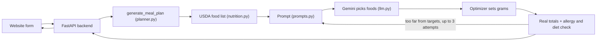

Live demo: https://nutrigen-2xkl.onrender.com (free tier, may take about a minute to wake up)

NutriGen is a personalized and proactive meal planner. Google Gemini chooses
the foods, an optimizer sets the portions, and every calorie and macro is
calculated from a USDA database of 8,002 foods, never taken from the AI.
No model was trained: NutriGen uses a pretrained model through its API.

Why: when we asked Gemini for a 2,000 kcal day and added up the foods with
USDA values, the plan was about 2,735 kcal (37% over). NutriGen closes that gap.

## How it works



1. The user profile (targets, diet, allergies, preferences) comes in.
2. Foods matching the profile are looked up in the USDA database. Foods that
   break an allergy, diet or restriction are removed before Gemini sees them.
3. Gemini picks foods for breakfast, lunch, snack and dinner (JSON, foods only).
4. A SciPy optimizer (`lsq_linear`) sets the grams so calories, protein, carbs
   and fat are all close to the targets, with realistic portion limits.
5. Totals are calculated from the database and compared with the targets.
   A plan that breaks an allergy or diet rule is never returned.
6. If a nutrient is more than 10% off, Gemini gets feedback and tries again
   (up to 3 attempts).

## Folder overview

| Path | What it does |
|---|---|
| `planner.py` | `generate_meal_plan(profile)`: the pipeline above |
| `nutrition.py` | Food lookup, calories and macros, allergy, diet and restriction rules |
| `prompts.py` | System prompt, grounded prompt, food keywords, proactive prompts |
| `llm.py` | Gemini connection (`send_prompt`, `send_prompt_json`) |
| `proactive.py` | User state, triggers, decision rules, scheduler, written messages, cooldown |
| `evaluation.py` | Error metrics, structure check, compliance check, 14-profile runner |
| `backend/` | FastAPI app (`main.py`, `models.py`, `nutrition.py` for BMR and targets) |
| `frontend/` | Website (HTML, CSS, JavaScript, light and dark theme) |
| `data/clean/nutrition_clean.csv` | The cleaned USDA database |
| `data/test_profiles.json` | 14 test profiles used by the evaluation |
| `result/evaluation_results.json` | Saved results of the last evaluation run |
| `test/` | Automated tests (pytest) |
| `build_fulldata.py`, `build_paper_data.py`, `clean_data.py`, `fetch_data.py` | Scripts that built the database |
| `docs/docs/api_contract.md` | The API contract between backend and frontend |

## Data

USDA FoodData Central: Foundation foods (395), SR Legacy (7,793) and a sample
of 200 Branded foods, 8,388 rows in total. Cleaning drops missing values,
impossible values (protein, fat or carbs above 100 g per 100 g, calories
outside 0 to 900) and duplicate names, leaving 8,002 foods. All values are
per 100 g, and many foods are raw or dry weights (for example oats, dry).

## Setup

Python 3.10 or newer (we used 3.13).

```
pip install -r requirements.txt
```

Create a file named `.env` in the project folder (it is ignored by git):

```
GEMINI_API_KEY=your_key_here
```

`USDA_API_KEY` is only needed to run `fetch_data.py`.


## Run the app

Run these from the project folder, in two terminals.

Backend:

```
uvicorn backend.main:app --reload
```

Frontend:

```
python -m http.server 5500 --directory frontend
```

Open http://127.0.0.1:5500/ for the website. The API documentation is at
http://127.0.0.1:8000/docs. The backend only accepts the frontend on port 5500.

## Use the planner from Python

```python
from planner import generate_meal_plan

profile = {
    "calories": 2000, "protein": 110, "carbs": 230, "fat": 65,
    "diet": "Vegetarian",            # Vegetarian, Non-Vegetarian or Vegan
    "allergies": ["Tree Nuts"],      # Milk, Peanuts, Tree Nuts, Soy, Gluten, Fish, Shellfish, Eggs
    "preferences": ["High Protein"], # also: Dairy Free
    "restrictions": [],              # No Seafood, No Red Meat, No Pork
}
output = generate_meal_plan(profile)
print(output["passed"], output["result"]["day_totals"])
```

It returns `result` (meals, day totals, comparison with the targets),
`passed` (all four nutrients within 10%), `best_attempt` and `problems_left`.
It raises `RuntimeError` if no safe plan could be made.

## API

`POST /generate-meal` takes the profile form (name, age, height, gender, goal,
weight, target, activity, diet, preferences, allergies, restrictions and the
free-text fields). It calculates BMR, TDEE and the macro targets, calls the
planner, and returns the meals, day totals, the comparison with the targets,
`passed` and `problems_left`.

## Proactive reminders

`proactive.py` watches a user's day and sends a short, friendly nudge.

- Triggers: no meal logged by 11 am, more than 5 hours since the last meal,
  low calories or protein in the evening, over the calorie target.
- A rule table decides which nudge goes first, and Gemini writes the message.
- Safety: the message is checked against the user's diet and allergies, and a
  plain template is sent instead if the call fails or the text is unsafe.
- Notification control: each trigger waits 3 to 6 hours before repeating, at
  most 4 nudges a day, and the user can switch nudges off.

## Tests and evaluation

```
python -m pytest test/ -v
```

Use `test/` on purpose: a few scripts in the root folder (`test_llm.py`,
`test_gemini.py`, `test_proactive_message.py`) call the Gemini API.

```
python evaluation.py
```

This runs the planner on the 14 profiles in `data/test_profiles.json` (up to
about 40 Gemini calls) and saves the results in `result/evaluation_results.json`.

Results of the last run (17 Nov 2026):

| Measure | Result |
|---|---|
| Plans generated | 14 of 14 |
| Within 10% on all four nutrients | 12 of 14 |
| Mean percentage error | 4.3% |
| Mean absolute error | calories 104.6 kcal, protein 4.5 g, carbs 10.5 g, fat 2.5 g |
| Allergy and diet compliance | 14 of 14 (100%) |
| Valid plan structure | 14 of 14 |
| Seconds per plan | mean 18.6, max 53.8 (typically 4 to 8 without retries) |

The two plans outside 10% were a gluten-free profile and a profile whose
macros do not add up to its calories (2,000 kcal with 150 g protein, 300 g
carbs and 100 g fat is about 2,700 kcal), which no plan can match. Timings
include waits after Gemini "high demand" (503) errors, so they vary.

## Limitations

- USDA is US-focused, so regional and Indian foods are limited.
- Allergy and diet rules are keyword lists. They are strict for common
  allergens, but they are not a medical guarantee. NutriGen is not medical advice.
- The free-text "foods to avoid" field is only a hint to Gemini, not enforced.
- The compliance check uses the same word lists as the planner, so it confirms
  the pipeline keeps its promise but is not an independent audit.
- The 14 test profiles were made by hand: this is a test set, not a benchmark.
- The proactive layer is connected to the website through the `/proactive/...` routes in the backend and `proactive.js` in the frontend.
## Team

Neil Gogte Institute of Technology.

- Aahana: nutrition data and retrieval, Gemini integration, prompts, meal
  planner, proactive layer, evaluation.
- Rishab: FastAPI backend and integration.
- Tanush: website (forms, meal plan view, chat).